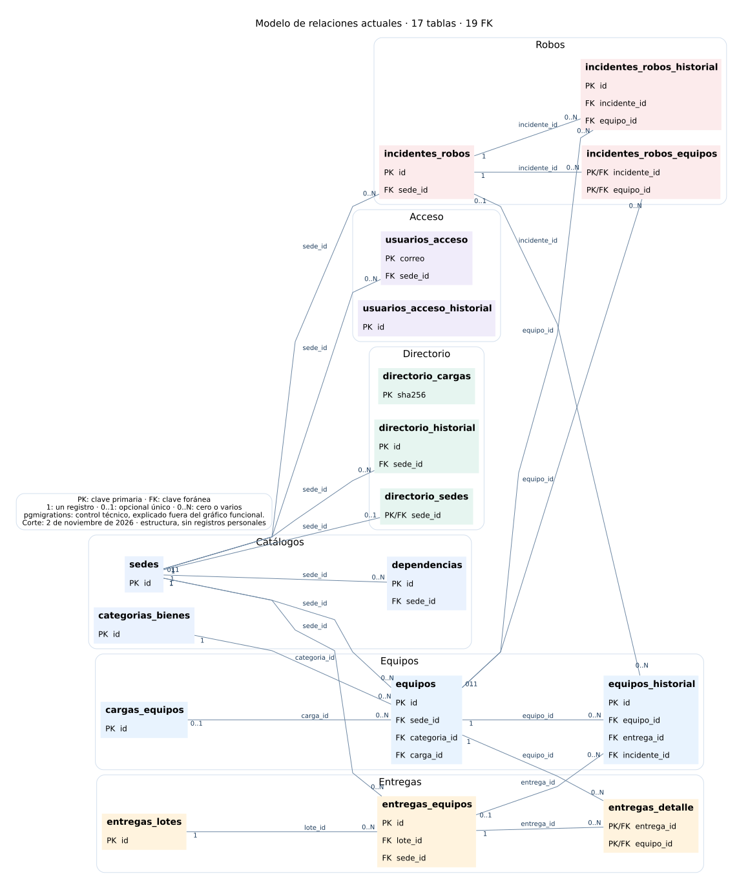

# Inventario 2.0 EE y TI — Informe de avance

**SLEP Barrancas · UTIC · Corte: 2 de noviembre de 2026 (Chile).**
Base revisada: `86e11add01ce6f76a361e0eb34b6d1d31b7363e4`, con PR #38 integrado.
Documento de avance: implementación, validación y despliegue son estados distintos.

## Propósito

Reunir la identificación de equipos de Nivel Central y de EE/JISC, su historial,
las entregas históricas y los incidentes de robo en un registro trazable, con
acceso institucional y permisos por sede. La información permite preparar
posteriormente las asignaciones completas y los indicadores de gestión.

## Resultado disponible en el código

| Capacidad | Implementado | Límite o siguiente paso |
| --- | --- | --- |
| Acceso y perfiles | Google Workspace, cuentas autorizadas, cinco perfiles y alcance por sede | Revisión operativa continua de cuentas y configuración privada |
| Catálogos | Sedes, dependencias y categorías | Dependencias aún no se vincula directamente a equipos por FK |
| Inventario | Consultas separadas NC/P02, registro, carga con vista previa, ficha y edición con historial | Asignaciones/devoluciones/traspasos completos siguen pendientes |
| Bodega y entregas | Consulta de pendientes y regularización histórica de entregas a jardines | Usa antecedentes y enlaces de actas existentes; no genera ni firma actas nuevas |
| Directorio | Datos del establecimiento y director/a, contactos, edición e historial | Importación privada del listado real pendiente de ejecutar en CentOS |
| Robos | Reporte, revisión, recuperación por equipo y consolidado por sede | Dashboard de establecimientos pendiente |
| Presentación | Portadas y submenús, tablas comunes, revisión móvil y movimiento reducido | Instalación de la versión más reciente en CentOS pendiente de comprobar |
| Modelo de datos | Consulta administrativa del esquema, columnas, relaciones, uso y exportación SVG | Los recuentos actuales se obtienen de la instalación consultada |
| Solicitudes | Portada y estructura de navegación | Operaciones y tablas del flujo aún no implementadas |
| Respaldos | Herramientas de copia local, cifrado, recuperación y control | Programación documentada en desarrollo; verificar operación; avisos por correo y borrado automático pendientes |

Los PR #37 y #38 están integrados en GitHub. La última evidencia de CentOS recibida
confirma la migración `1793923200000_directorio-establecimientos` y respuesta HTTP
200 de la web/directorio. Esa evidencia no acredita el despliegue de las mejoras
posteriores ni la importación de nombres y contactos del listado.

## Modelo y trazabilidad

La estructura revisada contiene **17 tablas funcionales**, **1 tabla técnica de
migraciones** y **19 claves foráneas** entre las tablas funcionales. Hay nueve
migraciones en el repositorio. Una FK expresa una relación comprobada por PostgreSQL.

| Área | Tablas funcionales | Para qué sirven |
| --- | ---: | --- |
| Catálogos | 3 | Sedes, ubicaciones internas y clasificación de bienes |
| Acceso | 2 | Cuentas, alcance e historial de permisos |
| Equipos | 3 | Registro estable, origen de cargas e historial |
| Directorio | 3 | Responsable vigente, cambios y control de cargas |
| Entregas | 3 | Lotes, entregas por sede y equipos incluidos |
| Robos | 3 | Incidente, equipos afectados y seguimiento |
| **Total funcional** | **17** | La tabla técnica adicional es `pgmigrations` |

El [modelo completo de atributos](jefatura/modelo-atributos.svg) y el
[modelo Mermaid con diccionario de tablas](modelo-entidad-relacion.md) permiten
ampliar los detalles. Los SVG se pueden abrir, ampliar y descargar sin entrar al servidor.

Un equipo conserva su identidad interna y sus cambios. Los registros históricos
guardan el usuario, fecha, motivo y datos anteriores/posteriores. Las entregas
conservan la persona y datos de recepción de ese momento: cambiar al director/a
vigente no cambia lo ya registrado. Reportar robo no elimina el equipo ni ejecuta
una baja; la validación y la recuperación son eventos distintos.

No se dibujan FK inexistentes: los usuarios/actores históricos conservados como
texto y los datos dentro de JSON no se presentan como relaciones al directorio
actual. Tampoco se presentan tablas de solicitudes o asignaciones aún no construidas.

## Evidencia de verificación

- 87 pruebas unitarias de la base de validación y 242 comprobaciones HTTP de la
  versión revisada, con datos ficticios y PostgreSQL 18 temporal.
- Revisión de dependencias, ESLint, compilación y comprobaciones de migraciones,
  permisos, catálogos, cifrado y restauración en GitHub Actions.
- Revisión de Chromium en escritorio y móvil: fichas, filtros, edición, carga,
  ingreso mínimo de robo, selección del modelo, SVG y navegación por teclado.
- [Verificación del último cambio de código](https://github.com/FSilva-SLEPB/inventario-barrancas/actions/runs/41560559496): aprobada.
- [PR #37](https://github.com/FSilva-SLEPB/inventario-barrancas/pull/37) y
  [PR #38](https://github.com/FSilva-SLEPB/inventario-barrancas/pull/38): integrados.

Las pruebas automáticas no son una certificación de producción ni una medida de
cobertura porcentual. No se informa un porcentaje de avance sin un alcance y
criterios de aceptación aprobados. Los recuentos de equipos o incidentes reales
no se han actualizado desde este entorno y no se presentan como cifras vigentes.

## Operación y continuidad

Los datos habituales se administran desde las pantallas autorizadas. Los cambios
de código se editan en una copia de desarrollo, se prueban, se revisan por PR y
se despliegan como una versión identificada. El código y la base tienen respaldos
y ciclos distintos. Ver [guía de operación y mantenimiento](operacion-y-mantenimiento.md).

La configuración actual de Compose ejecuta `next dev` y escucha en la interfaz
local del servidor. Para operación definitiva falta preparar y comprobar el
servicio de producción, dominio/HTTPS, supervisión, avisos y recuperación medible.

## Próximas etapas propuestas

1. Actualizar y verificar CentOS; importar el directorio real con revisión por RBD.
2. Definir y completar asignaciones, devoluciones, reasignaciones y reparación de
   Nivel Central, con funcionarios y trazabilidad del mismo equipo.
3. Completar entregas/traspasos y generación de actas nuevas según el flujo aprobado.
4. Implementar suministros y solicitudes de insumos; después el dashboard sobre
   movimientos e incidentes validados.
5. Preparar la operación productiva y el relevo técnico, en paralelo con los módulos.

El orden y las fechas requieren acuerdo; esta lista no constituye un calendario
comprometido. Antes de usarlo como servicio definitivo se propone acordar responsables,
infraestructura, prioridad funcional, pérdida de datos máxima aceptable y tiempo de
recuperación objetivo.

## Material para presentar

- [Informe PDF](jefatura/avance-inventario.pdf).
- [Presentación PowerPoint editable](jefatura/avance-inventario.pptx).
- [Modelo de relaciones SVG](jefatura/modelo-relaciones.svg).
- [Modelo con atributos SVG](jefatura/modelo-atributos.svg).
- [Índice y notas de uso](jefatura/README.md).
