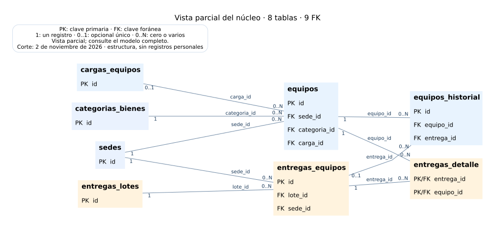

# Material para jefatura

**Corte: 2 de noviembre de 2026 (Chile).** Código revisado hasta el PR #38,
commit `86e11add01ce6f76a361e0eb34b6d1d31b7363e4`.

| Documento | Uso |
| --- | --- |
| [Informe PDF](avance-inventario.pdf) | Resumen imprimible del alcance, modelo, pruebas, operación y pendientes |
| [Presentación PowerPoint](avance-inventario.pptx) | Diapositivas editables para reunión; descargar el archivo desde GitHub |
| [Vista parcial del núcleo](modelo-principal.svg) | Ocho tablas y nueve relaciones para una explicación inicial |
| [Modelo de relaciones SVG](modelo-relaciones.svg) | 17 tablas funcionales y 19 FK; ampliar en el navegador |
| [Modelo de atributos SVG](modelo-atributos.svg) | Estructura detallada de las tablas; ampliar para leer cada campo |
| [Informe en Markdown](../informe-avance-jefatura.md) | Texto del avance con vínculos verificables |
| [Guía de mantenimiento](../operacion-y-mantenimiento.md) | Cómo editar datos, modificar código, actualizar y mantener la instalación |
| [Diccionario y Mermaid](../modelo-entidad-relacion.md) | Tablas, campos, relaciones y propósito |

Los gráficos se construyen desde el modelo documentado y comprobado con las
migraciones; no exportan filas de la base ni datos personales. La tabla técnica
`pgmigrations` se explica aparte del gráfico funcional. Las capturas de demostración,
si se utilizan en una reunión, corresponden a datos ficticios y deben indicarlo.

La presentación y el informe no afirman que la versión de GitHub ya esté instalada
en CentOS. La importación real del directorio y la verificación del último despliegue
siguen pendientes. No contienen cifras vigentes de inventario ni porcentajes de avance.

La nulabilidad de cada columna se consulta en la pantalla Modelo de datos; otros
índices y reglas se revisan en las migraciones.



El generador usa la fuente fijada `docs/fuentes/modelo-corte-pr39.md` para
reproducir este corte. El esquema y los avances posteriores se consultan en
[modelo actual](../modelo-entidad-relacion.md) y en las notas de cada módulo.

## Actualizar este material

El texto de referencia es `docs/informe-avance-jefatura.md`; el esquema completo
está en `docs/modelo-entidad-relacion.md`. Para regenerar los gráficos y entregables,
se necesita Python 3, Graphviz (`dot`) y las dependencias opcionales de
`docs/fuentes/requisitos.txt`, en un entorno separado de la aplicación:

```bash
python3 docs/fuentes/generar-material.py
```

El generador corresponde al corte descrito. Antes de publicar otro corte se deben
actualizar fecha, commit, estados y evidencias en los documentos y en su fuente,
y revisar visualmente los entregables. Un cambio de código o de una tabla no
actualiza por sí solo las afirmaciones del informe. Los nuevos archivos se revisan
por PR igual que el resto de la documentación.
