# Modelo entidad relación del inventario

Este documento se genera desde una base con las migraciones del repositorio.
El modelo es documentación técnica para administradores, fuera del menú operativo de Mantenedores, en /documentacion/modelo-datos.

```mermaid
erDiagram
  actas_contador {
    boolean id PK
    bigint ultimo
  }
  actas_documentos {
    uuid id PK
    uuid movimiento_id FK
    bigint folio
    integer version
    text actor
    jsonb solicitud
    jsonb datos
    bytea pdf
    text sha256
    timestamp_with_time_zone emitido_en
    uuid entrega_id FK
  }
  actas_envios {
    uuid id PK
    uuid acta_id FK
    text actor
    text__ destinatarios
    text estado
    text remitente
    uuid token
    jsonb resultado
    timestamp_with_time_zone creado_en
    timestamp_with_time_zone terminado_en
  }
  cargas_equipos {
    uuid id PK
    text actor
    text archivo
    text sha256
    integer cantidad
    timestamp_with_time_zone registrado_en
  }
  categorias_bienes {
    uuid id PK
    text nombre
    boolean activo
    timestamp_with_time_zone creado_en
  }
  celulares {
    uuid id PK
    uuid sede_id FK
    text telefono
    text marca
    text modelo
    text imei
    text numero_inventario
    text condicion_tecnica
    text responsable
    text observaciones
    boolean activo
    integer version
    text creado_por
    timestamp_with_time_zone creado_en
    text actualizado_por
    timestamp_with_time_zone actualizado_en
    text custodia
  }
  celulares_historial {
    bigint id PK
    uuid celular_id FK
    text actor
    text motivo
    jsonb antes
    jsonb despues
    timestamp_with_time_zone registrado_en
    uuid movimiento_id FK
  }
  dependencias {
    uuid id PK
    uuid sede_id FK
    text nombre
    boolean activo
    timestamp_with_time_zone creado_en
  }
  directorio_cargas {
    text sha256 PK
    text actor
    text archivo
    integer cantidad
    timestamp_with_time_zone registrado_en
  }
  directorio_historial {
    uuid id PK
    uuid sede_id FK
    text actor
    text motivo
    jsonb antes
    jsonb despues
    timestamp_with_time_zone registrado_en
  }
  directorio_sedes {
    uuid sede_id PK, FK
    text nombre
    text cargo
    integer version
    text actualizado_por
    timestamp_with_time_zone actualizado_en
    text rut
    text correo
    text situacion
    text observaciones
    text nombres
    text apellidos
  }
  entregas_detalle {
    uuid entrega_id PK, FK
    uuid equipo_id PK, FK
    jsonb antes
    jsonb despues
  }
  entregas_equipos {
    uuid id PK
    uuid lote_id FK
    uuid sede_id FK
    text sede_nombre
    text sede_rbd
    text comuna
    date fecha_entrega
    text receptor_nombre
    text receptor_cargo
    text tipo
    boolean acta_sin_folio
    text enlace_acta
    jsonb receptor_datos
    jsonb sede_datos
  }
  entregas_lotes {
    uuid id PK
    text actor
    jsonb datos
    integer cantidad
    timestamp_with_time_zone registrado_en
  }
  equipos {
    uuid id PK
    uuid sede_id FK
    uuid categoria_id FK
    text marca
    text modelo
    text serie
    text numero_inventario
    text motivo_identificacion
    text origen
    text situacion
    text condicion_tecnica
    jsonb datos_compra
    date fecha_entrega
    text enlace_acta
    text observaciones
    uuid carga_id FK
    integer fila_origen
    integer version
    text creado_por
    timestamp_with_time_zone creado_en
    timestamp_with_time_zone actualizado_en
    text custodia
  }
  equipos_historial {
    bigint id PK
    uuid equipo_id FK
    text actor
    text motivo
    jsonb antes
    jsonb despues
    timestamp_with_time_zone registrado_en
    uuid entrega_id FK
    uuid incidente_id FK
    uuid movimiento_id FK
  }
  funcionarios_nc {
    uuid id PK
    text nombre
    text rut
    text correo
    text unidad
    text subdireccion
    text cargo
    date fecha_ingreso
    boolean activo
    integer version
    text creado_por
    timestamp_with_time_zone creado_en
    text actualizado_por
    timestamp_with_time_zone actualizado_en
  }
  funcionarios_nc_historial {
    bigint id PK
    uuid funcionario_id FK
    text actor
    text motivo
    jsonb antes
    jsonb despues
    timestamp_with_time_zone registrado_en
  }
  incidentes_robos {
    uuid id PK
    uuid sede_id FK
    text sede_nombre
    text sede_rbd
    text sede_tipo
    text comuna
    date fecha
    text lugar
    text descripcion
    text enlace
    text estado
    integer version
    text reportado_por
    timestamp_with_time_zone registrado_en
    jsonb solicitud
  }
  incidentes_robos_equipos {
    uuid incidente_id PK, FK
    uuid equipo_id PK, FK
    jsonb identificacion
    date recuperado_fecha
    text recuperado_por
    text recuperacion_motivo
  }
  incidentes_robos_historial {
    uuid id PK
    uuid incidente_id FK
    uuid equipo_id FK
    text evento
    text actor
    text motivo
    jsonb datos
    timestamp_with_time_zone registrado_en
  }
  movimientos_inventario {
    uuid id PK
    uuid equipo_id FK
    uuid celular_id FK
    text accion
    date fecha
    text receptor
    uuid origen_sede_id FK
    uuid destino_sede_id FK
    text actor
    text motivo
    jsonb solicitud
    jsonb antes
    jsonb despues
    timestamp_with_time_zone registrado_en
  }
  prestamos_inventario {
    uuid id PK, FK
    uuid equipo_id FK
    uuid celular_id FK
    uuid origen_sede_id FK
    uuid destino_sede_id FK
    date fecha_salida
    date fecha_limite
    text receptor
    jsonb datos_destino
    text estado
    uuid movimiento_devolucion_id FK
    date fecha_devolucion
  }
  sedes {
    uuid id PK
    text tipo
    text nombre
    text rbd
    text direccion
    text comuna
    text correo_institucional
    boolean activo
    timestamp_with_time_zone creado_en
  }
  usuarios_acceso {
    text correo PK
    text rol
    boolean activo
    timestamp_with_time_zone creado_en
    text nombre
    integer version
    timestamp_with_time_zone actualizado_en
    uuid sede_id FK
  }
  usuarios_acceso_historial {
    bigint id PK
    text actor
    text correo
    jsonb antes
    jsonb despues
    timestamp_with_time_zone registrado_en
  }
  entregas_equipos |o--o| actas_documentos : "entrega_id"
  movimientos_inventario |o--o| actas_documentos : "movimiento_id"
  actas_documentos ||--o{ actas_envios : "acta_id"
  sedes ||--o{ celulares : "sede_id"
  celulares ||--o{ celulares_historial : "celular_id"
  movimientos_inventario |o--o{ celulares_historial : "movimiento_id"
  sedes ||--o{ dependencias : "sede_id"
  sedes ||--o{ directorio_historial : "sede_id"
  sedes ||--o| directorio_sedes : "sede_id"
  entregas_equipos ||--o{ entregas_detalle : "entrega_id"
  equipos ||--o{ entregas_detalle : "equipo_id"
  entregas_lotes ||--o{ entregas_equipos : "lote_id"
  sedes ||--o{ entregas_equipos : "sede_id"
  cargas_equipos |o--o{ equipos : "carga_id"
  categorias_bienes ||--o{ equipos : "categoria_id"
  sedes ||--o{ equipos : "sede_id"
  entregas_equipos |o--o{ equipos_historial : "entrega_id"
  equipos ||--o{ equipos_historial : "equipo_id"
  incidentes_robos |o--o{ equipos_historial : "incidente_id"
  movimientos_inventario |o--o{ equipos_historial : "movimiento_id"
  funcionarios_nc ||--o{ funcionarios_nc_historial : "funcionario_id"
  sedes ||--o{ incidentes_robos : "sede_id"
  equipos ||--o{ incidentes_robos_equipos : "equipo_id"
  incidentes_robos ||--o{ incidentes_robos_equipos : "incidente_id"
  equipos |o--o{ incidentes_robos_historial : "equipo_id"
  incidentes_robos ||--o{ incidentes_robos_historial : "incidente_id"
  celulares |o--o{ movimientos_inventario : "celular_id"
  sedes |o--o{ movimientos_inventario : "destino_sede_id"
  equipos |o--o{ movimientos_inventario : "equipo_id"
  sedes |o--o{ movimientos_inventario : "origen_sede_id"
  celulares |o--o{ prestamos_inventario : "celular_id"
  sedes ||--o{ prestamos_inventario : "destino_sede_id"
  equipos |o--o{ prestamos_inventario : "equipo_id"
  movimientos_inventario ||--o| prestamos_inventario : "id"
  movimientos_inventario |o--o| prestamos_inventario : "movimiento_devolucion_id"
  sedes ||--o{ prestamos_inventario : "origen_sede_id"
  sedes |o--o{ usuarios_acceso : "sede_id"
```

## Tablas y uso

| Tabla | Área | Uso en esta versión |
| --- | --- | --- |
| actas_contador | Actas | Secuencia única de folios, comenzando en 0; imprimir y reenviar no consumen otro número. |
| actas_documentos | Actas | Acta de movimiento o entrega histórica (una sola fuente), con folio, datos de la emisión y PDF conservado con su huella SHA-256. |
| actas_envios | Actas | Intentos y resultados de envío por correo del mismo PDF, con destinatarios, actor e idempotencia. |
| cargas_equipos | Equipos | Origen e idempotencia de las cargas masivas de inventario. |
| categorias_bienes | Catálogos | Categorías que clasifican los bienes y equipos. |
| celulares | Celulares | Inventario dedicado de celulares, un teléfono por equipo, sede, identificación, funcionamiento y vigencia. |
| celulares_historial | Celulares | Cambios de datos, número, sede y vigencia del celular con actor, motivo e instantáneas históricas. |
| dependencias | Catálogos | Ubicaciones internas de una sede. Todavía no hay una FK desde equipos a dependencias. |
| directorio_cargas | Directorio | Registro del hash de cada listado cargado para evitar duplicar cambios. |
| directorio_historial | Directorio | Cambios de responsable y datos del establecimiento; conserva las personas anteriores. |
| directorio_sedes | Directorio | Responsable vigente de cada EE/JISC, RUN, contactos y situación del cargo. |
| entregas_detalle | Entregas | Equipos de cada entrega, con instantáneas anteriores y posteriores. |
| entregas_equipos | Entregas | Cabecera de entrega por sede, fecha y persona receptora; conserva sus datos históricos. |
| entregas_lotes | Entregas | Agrupa una operación de entrega y evita repetirla al reintentar. |
| equipos | Equipos | Identidad estable del bien, sede, categoría, funcionamiento, custodia en Bodega TI/asignado/en préstamo y situación de entrega. |
| equipos_historial | Equipos | Ingresos, ediciones, entregas e incidentes con datos anteriores y posteriores. |
| funcionarios_nc | Nivel Central | Ficha administrativa de funcionarios NC, unidad, contacto y vigencia; separada del acceso al sistema. |
| funcionarios_nc_historial | Nivel Central | Cambios de la ficha del funcionario con actor, motivo y datos anteriores/posteriores. |
| incidentes_robos | Robos | Reporte de robo por sede, antecedentes, validación y estado. |
| incidentes_robos_equipos | Robos | Equipos afectados y recuperación individual dentro de un incidente. |
| incidentes_robos_historial | Robos | Reporte, revisión y recuperación con usuario, fecha y motivo. |
| movimientos_inventario | Movimientos | Asignaciones, devoluciones y préstamos de equipos y celulares, con fecha, receptor, idempotencia e instantáneas. |
| pgmigrations | Migraciones | Control técnico de las migraciones aplicadas; no es una tabla de negocio. |
| prestamos_inventario | Préstamos | Préstamos temporales desde Bodega TI, pertenencia conservada, destino y plazo, devolución vinculada e historial en movimientos. |
| sedes | Catálogos | Identidad y datos de EE/JISC y Nivel Central; alcance por sede. |
| usuarios_acceso | Acceso | Cuentas autorizadas, perfil, vigencia y sede permitida. |
| usuarios_acceso_historial | Acceso | Auditoría de cambios de usuarios y permisos. |

## Relaciones y trazabilidad

- Directorio vigente: una ficha por sede. La clave primaria de directorio_sedes es también FK a sedes (0..1 ficha por sede).
- Equipos: cada bien conserva su UUID, sede y categoría. Las cargas masivas se identifican en cargas_equipos.
- Entregas: un lote agrupa entregas por sede; cada entrega tiene varios equipos en entregas_detalle.
- Celulares: inventario dedicado con sede y un número móvil por equipo; celulares_historial conserva números anteriores, cambios de sede y vigencia. Dos por EE/JI es una referencia, no una restricción.
- Actas: cada documento se vincula a un movimiento y conserva folio, datos y PDF con su SHA-256; actas_envios registra los intentos y resultados de correo. actas_contador mantiene la secuencia única desde 0.
- Préstamos: cada préstamo conserva el bien y su sede de pertenencia, destino temporal, plazo, movimiento de salida y devolución exacta. Solo uno activo por bien; se consulta por UTIC fuera del inventario recibido del destinatario.
- Movimientos: equipos y celulares comparten devolución a Bodega TI y asignación a sede; cada movimiento refiere exactamente a un bien y conserva antes/después. Las ubicaciones físicas de Bodega TI se definirán después.
- Robos: el incidente tiene sede y varios equipos; la recuperación se registra por equipo.
- Los historiales conservan el actor como texto y los valores anteriores/posteriores como JSON; no dependen de que ese usuario o director siga vigente.
- Los nombres, RUN y contactos conservados en instantáneas no son FK al directorio actual.
- Dependencias pertenece a sedes; todavía no existe una FK de equipos a dependencias.
- Funcionarios de Nivel Central tiene ficha e historial propios. Las entregas a funcionarios conservan los datos seleccionados en el documento; todavía no hay una FK desde equipos a funcionarios. Habilitación y solicitudes siguen pendientes.
- pgmigrations es infraestructura de migraciones y se excluye del gráfico de negocio.

El número de filas no prueba por sí solo el uso de una tabla. El catálogo anterior registra sus funciones actuales; una tabla vacía puede pertenecer a un flujo que todavía no tiene movimientos.
