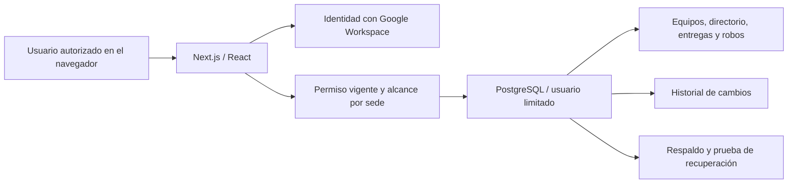

> Estado actualizado el 3 de noviembre: la web de CentOS ya usa la imagen
> compilada con `compose.produccion.yaml`, para acceso local en localhost mediante
> SSH. Se verificaron contenedor saludable, HTTP 200 y estabilidad del navegador.
> Para actualizarla hay que reconstruir la imagen y recrear solo la web con
> `-p inventario-barrancas -f compose.produccion.yaml` y `--no-deps`. Un `git pull`
> seguido de `start` no incorpora cambios a una imagen compilada. El dominio y
> HTTPS definitivos siguen pendientes. PostgreSQL conserva su configuración
> anterior; su política de arranque se revisará en la puesta en producción completa.

# Operación y mantenimiento del inventario

Guía para UTIC del SLEP Barrancas. Corte funcional: 2 de noviembre de 2026.
Referencia revisada: `86e11add01ce6f76a361e0eb34b6d1d31b7363e4` (PR #38 integrado).

El sistema y su código quedan en el repositorio institucional que se defina para
su custodia. Se puede mantener con otro desarrollador; esta conversación no es
necesaria para ejecutar la aplicación. El relevo requiere código, documentación,
accesos autorizados, configuración privada y recuperación de respaldos.

## 1. Qué se cambia y desde dónde

| Necesidad | Lugar de trabajo | Responsable |
| --- | --- | --- |
| Cambiar director/a, contactos y datos del establecimiento | Mantenedores → Directorio → Ver ficha → Editar | Perfil administrativo autorizado |
| Administrar cuentas, perfiles, sedes, dependencias y categorías | Mantenedores, según permisos | Administrador o encargado en su alcance |
| Registrar o editar equipos, entregas históricas e incidentes | Inventario, según permisos | UTIC o encargado autorizado |
| Cambiar textos, formularios, tablas o nuevas funciones | Código, en una rama de Git; revisión por PR | Desarrollador de UTIC o proveedor autorizado |
| Cambiar tablas y reglas persistentes | Nueva migración revisada y probada | Responsable técnico de aplicación/base de datos |
| Actualizar servicio, dominio, certificados y copias | Infraestructura de la instalación | Administrador del servidor |

Editar el directorio conserva su historial y no cambia los datos de entregas
anteriores. Director/a del establecimiento y usuario con permiso para entrar son
registros distintos: cargar una persona en el directorio no le da acceso.

## 2. Cómo funciona



React dibuja la interfaz y Next.js ejecuta las páginas y operaciones del servidor.
PostgreSQL guarda los registros y sus relaciones. Docker Compose organiza la web,
la base y la ejecución de migraciones. Git/GitHub conservan versiones del código;
**Git no respalda los registros de PostgreSQL**.

La cuenta web de PostgreSQL tiene permisos limitados. Los permisos se comprueban
al consultar o guardar, y en las funciones SQL controladas que lo requieren;
ocultar un botón no reemplaza esa autorización. El historial conserva usuario,
fecha y antecedentes del cambio.

## 3. Dónde está cada parte del código

| Ruta | Contenido y ejemplos de cambio |
| --- | --- |
| `web/src/app/` | Páginas, rutas y acciones del servidor; por ejemplo Inventario y Mantenedores |
| `web/src/components/` | Formularios, navegación, tablas y componentes compartidos |
| `web/src/app/experiencia.css` | Presentación común de tablas, módulos y transiciones |
| `web/src/app/tema-institucional.css` | Identidad visual y disposición institucional |
| `web/src/lib/` | Consultas, validaciones, autorización y reglas de los módulos |
| `web/migrations/` | Cambios versionados de PostgreSQL, sus funciones y permisos |
| `web/tests/` | Pruebas unitarias y de integración HTTP |
| `.github/workflows/verificaciones-web.yml` | Verificaciones automáticas de los PR y de `main` |
| `compose.yaml` | Entorno Docker de desarrollo actual |
| `scripts/`, `database/`, `deploy/` | Preparación, comprobaciones, respaldos y control de operación |
| `docs/` | Alcance, decisiones, procedimientos y modelo de datos |

## 4. Cómo modificar el código

Un editor como Visual Studio Code sirve para trabajar con la copia del proyecto.
Se recomienda una copia de desarrollo y una base de prueba separadas del servidor
con datos reales. La preparación está en [README](../README.md) y el acceso de
prueba en [Acceso institucional](acceso-institucional.md).

Flujo habitual:

1. Actualizar la copia de desarrollo desde `main` y crear una rama para un cambio.
2. Editar y probar con datos ficticios. Conservar controles de acceso e historial.
3. Revisar `git diff`; añadir solo los archivos previstos y enviar la rama a GitHub.
4. Abrir un pull request: explicar el cambio, cómo probarlo y si requiere migración.
5. Esperar las verificaciones automáticas y la revisión funcional.
6. Integrar y registrar el commit aprobado. Desplegar esa versión en una ventana definida.
7. Probar el servicio instalado y dejar constancia del resultado.

Ejemplo de inicio en una copia de desarrollo ya preparada:

```bash
git switch main
git pull --ff-only origin main
git switch -c mejora/descripcion-del-cambio
```

Los comandos de Git que siguen deben referirse a los archivos revisados del cambio.
Los secretos locales, archivos personales y respaldos permanecen fuera del PR.
Las pruebas y compilaciones se ejecutan en desarrollo o CI; no se compila sobre
el mismo directorio `.next` de una web que esté atendiendo usuarios.

Las versiones fijadas de las dependencias se instalan con `npm ci`. Una actualización
de Next.js, React, Node.js o PostgreSQL también se trata como un cambio revisado,
con prueba de compatibilidad y recuperación; no se actualiza por editar una etiqueta.

## 5. Actualización del servidor

El despliegue es una operación distinta de integrar un PR. Las pruebas de GitHub
no publican automáticamente el sistema en CentOS. En la instalación actual se
requiere acceso autorizado al servidor; las tareas diarias del usuario se realizan
por navegador cuando el servicio y su acceso estén disponibles.

Procedimiento de una actualización:

| Paso | Resultado que se debe comprobar antes de continuar |
| --- | --- |
| Identificar versión | PR aprobado, commit de origen y migraciones requeridas conocidos; copia del servidor sin cambios locales sin resolver |
| Preparar ventana | Avisar la interrupción y detener la web cuando el cambio lo requiera |
| Respaldar y verificar | Copia de PostgreSQL creada y restauración comprobada en un entorno aislado |
| Instalar versión | Código aprobado y dependencias fijadas disponibles |
| Migrar si corresponde | Migraciones de esa versión completas, sin errores |
| Iniciar y comprobar | Servicio disponible; inicio de sesión, permisos, consulta y una operación autorizada probados |
| Registrar cierre | Commit desplegado, respaldo previo, migraciones y resultado de comprobación anotados |

Los procedimientos existentes de [respaldo local](respaldos-postgresql.md),
[respaldo cifrado fuera del servidor](respaldo-postgresql-drive.md) y
[control de copias](control-respaldos.md) describen sus comandos y requisitos.
No se incluyen aquí credenciales ni se ejecuta una actualización por leer esta guía.

Volver a una versión de código no revierte los datos. Antes de volver atrás se
verifica compatibilidad de esquema y código. Si hace falta recuperar datos,
se aplica un procedimiento de restauración probado, con autorización del responsable
y conservación de la situación previa; no se usa una migración inversa como sustituto.

## 6. Qué falta para la operación definitiva

`compose.yaml` declara **entorno de desarrollo**, ejecuta `next dev` y publica
solo `127.0.0.1:3000`. El acceso comprobado hasta ahora se ha hecho mediante túnel SSH.
La aplicación no está documentada como un servicio productivo ya publicado.

Para el uso institucional definitivo se preparará y verificará:

- Instalación de producción con compilación y proceso `next start` o despliegue
  equivalente soportado; configuración separada del desarrollo.
- Dominio, HTTPS, origen canónico y callback autorizado de Google Workspace.
- Supervisión, reinicio, registros y avisos con recepción comprobada.
- Ventanas de actualización y recuperación, custodia de credenciales y responsables.
- Frecuencia de respaldos acorde a los movimientos reales y a la pérdida de datos
  máxima aceptable; prueba de recuperación con tiempo medido.

No basta con abrir el puerto de desarrollo a Internet para completar esa etapa.

## 7. Rutina propuesta de mantenimiento

| Frecuencia | Revisión |
| --- | --- |
| Diaria / día hábil de operación | Disponibilidad, errores recientes, espacio, último respaldo y resultado del control |
| Semanal | Confirmar copia fuera del servidor y restauración de prueba; atender avisos y revisar cambios solicitados |
| Mensual | Revisar cuentas y perfiles, dependencias y parches del servidor; programar cambios y comprobar recuperación |
| Ante cambio de personal | Actualizar directorio y retirar/cambiar acceso de la persona; son tareas distintas |
| Ante incidente | Preservar registros, documentar impacto, recuperar según procedimiento y verificar datos/permisos |

El respaldo semanal y control diario fueron documentados y probados en la instalación
de desarrollo. Su estado actual debe verificarse cuando haya acceso. La retención
solo prepara un plan: el borrado automático y el transporte real de avisos por correo
siguen pendientes. La continuidad requiere además supervisión externa del servidor.

## 8. Relevo y custodia institucional

Se recomienda dejar identificados un responsable funcional, un responsable técnico
y un reemplazo autorizado. La institución debe poder recuperar el repositorio,
Google Cloud/Workspace, dominio, servidor, configuración privada y claves de respaldo.
No basta con que una sola persona conserve esos accesos.

La entrega técnica incluirá: versión instalada, modelo de datos, permisos, inventario
de configuración privada (sin publicar sus valores), procedimientos, constancias de
respaldo/restauración y lista de pendientes. Las claves de recuperación se custodian
separadas de las copias cifradas.

## 9. Cómo ver tablas y avances

- En el sistema, como administrador: `/documentacion/modelo-datos` (fuera del menú operativo). Muestra
  estructura, relaciones, uso y recuentos de esa instalación; permite descargar SVG.
- En GitHub, sin entrar a CentOS: [modelo detallado](modelo-entidad-relacion.md),
  [informe de avance](informe-avance-jefatura.md) y [material para reunión](jefatura/README.md).
- Los recuentos de equipos y movimientos de una instalación solo se informan como
  actuales después de consultarla. Una tabla vacía puede estar en uso funcional.

## Actualización de rutas de documentación

El modelo de datos está disponible solo para administradores en
`/documentacion/modelo-datos`, fuera del menú operativo de Mantenedores.
Los directorios y el cierre de edición se describen en
[Directorios separados](directorios-separados.md). La migración de esta revisión
es `1794096000000_directorios-separados`; no separa automáticamente nombres legados.

## Inventario de celulares

El [inventario de celulares](inventario-celulares.md) requiere la migración
`1794182400000_inventario-celulares`, además de reconstruir la web compilada.
Cada número identifica una línea vigente asociada a un equipo. Cambios de sede,
número y vigencia conservan historial; archivar no constituye una baja.
El dashboard de robos fue retirado; permanece el consolidado operativo.
